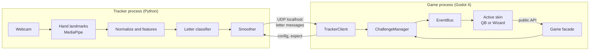
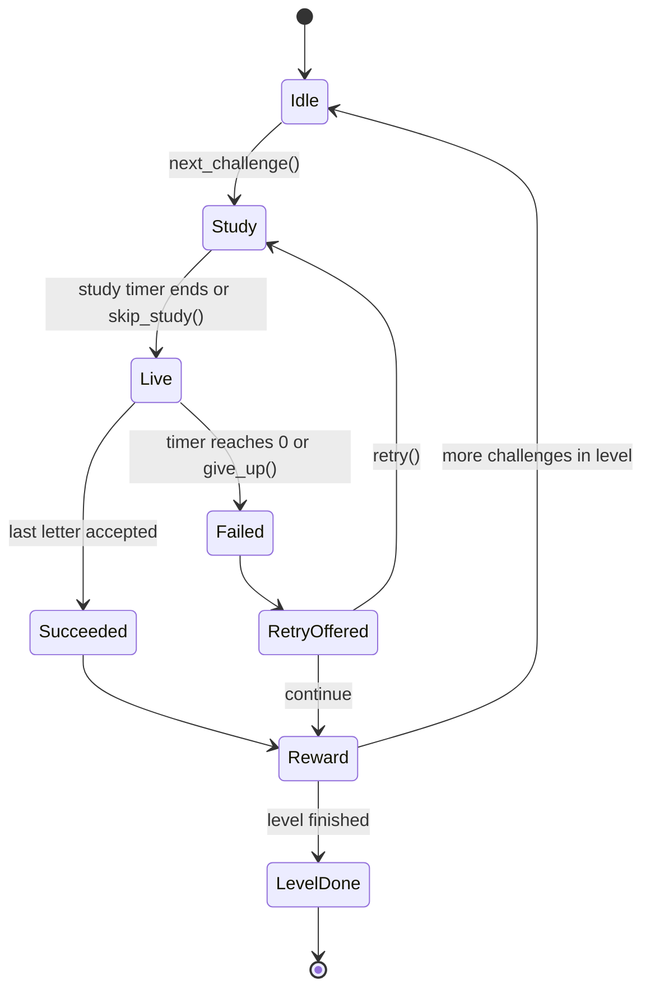
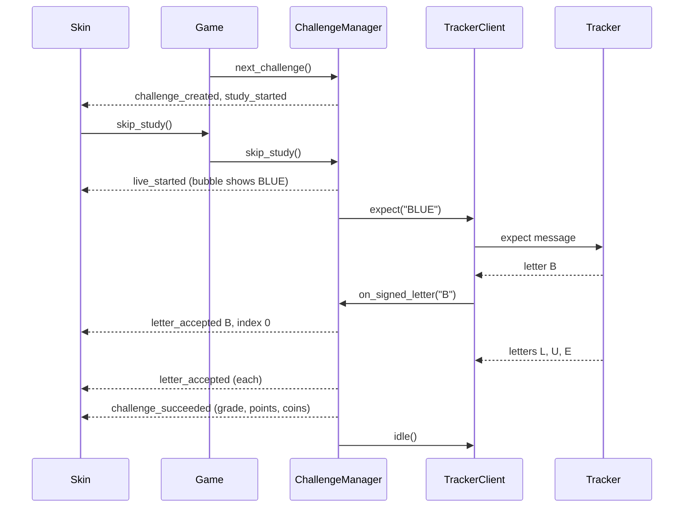

# Architecture

How Signcaster is built. Read GAME_DESIGN.md first for what it should do.

## Goals

- One engine, two skins. Game rules are written once and both modes reuse them.
- Playable without a webcam (Read it), better with one (Sign it).
- Runs smoothly on both team laptops: a MacBook with an Apple M5 and an HP Envy with an Intel Core i5 and integrated graphics.
- Private by design. Video never leaves the tracker process, nothing goes online.
- Easy for AI agents to work on safely: clear module boundaries, a written event contract, content in JSON, tests for logic.

## Non-goals (v1)

Online features, accounts, phone builds, full ASL grammar.

## The big picture

Two processes on the player's computer:



- The **tracker** turns webcam frames into letters. It knows nothing about the game.
- The **engine** (Godot autoloads) owns all rules: word picking, timers, grading, difficulty, coins, store, saving.
- The **skin** draws the world and plays animations. It reacts to EventBus signals and calls the `Game` facade.

## Godot project layout

```
game/
  project.godot
  engine/                 autoloads, pure logic, no art
    event_bus.gd          signals only (see EVENTS.md)
    config.gd             loads and validates content JSON
    word_bank.gd          word packs, spaced repetition boxes, word picking
    challenge_manager.gd  challenge state machine, timers, input checking, grading
    difficulty.gd         tiers, groups, rubber-banding
    economy.gd            coins, stars, bonuses
    store.gd              catalogs, purchases, equipped items
    save_system.gd        load, migrate, atomic save
    tracker_client.gd     UDP client for the tracker protocol
    clock.gd              wraps time so tests can control it
    game.gd               facade with the public API skins may call
  skins/
    menu/                 main menu and mode select
    debug/                plain buttons and labels, used for testing every engine feature
    qb/                   scenes/, scripts/, art/, sfx/, store/
    wizard/               same structure
  ui/                     shared themeable widgets: memory_bubble, timer_bar, sign_card, coin_counter, letter_slots
  content/                JSON (see DATA_FORMATS.md)
  tests/                  GUT tests, one file per engine script
  addons/gut/             test framework (installed in milestone 0)
```

### Autoload order

Order matters because later autoloads use earlier ones in `_ready()`:

1. `EventBus`
2. `Clock`
3. `Config`
4. `SaveSystem`
5. `WordBank`
6. `Difficulty`
7. `Economy`
8. `Store`
9. `TrackerClient`
10. `ChallengeManager`
11. `Game`

### Dependency rules

- `engine/` scripts may use other `engine/` scripts and `content/` files. Never `skins/` or `ui/`.
- `ui/` widgets are dumb: they expose properties and methods, and never call engine autoloads.
- `skins/` may use `ui/`, listen to `EventBus`, and call `Game`. Never call other autoloads directly.
- A grep check in CI enforces the first rule: no `skins/` or `ui/` paths inside `engine/`.

## Challenge lifecycle



`ChallengeManager` owns this state machine. Each transition emits the matching signal from EVENTS.md.
Pausing freezes the live timer in any state.

## A Sign it challenge, step by step



## Key algorithms

### Picking the next challenge

1. `Difficulty` gives the current tier: live seconds, word length range, bubble style, allowed directions, twist.
2. `WordBank` picks a word: about 70% from the current pack (new or learning words), about 30% review words that are due.
   Respect the tier's word length, the mode's `max_new_words_per_level`, and `kid_safe` in Wizard mode. Never repeat a word inside one level.
3. Pick a direction from the tier's list. If `TrackerClient` is not connected, use `read_it` and emit `sign_it_unavailable` once per session.
4. Apply the mode's `timer_scale` and the current rubber-band factor to `live_seconds`.

### Spaced repetition (Leitner boxes)

```
on success:  box = min(box + 1, boxes)
on fail:     box = 1
due when:    session_count - last_seen_session >= due_every_sessions[box - 1]
```

### Rubber-banding

```
factor starts at 1.0 at the start of each group
after 2 fails in a row:          factor = min(factor * ease_factor, max_ease)
after 3 fast successes in a row: factor = max(factor * harden_factor, max_harden)
live_seconds = tier.live_seconds * mode.timer_scale * factor
```

### Grading and points

```
remaining_ratio = time_left / live_seconds   (when the last letter is accepted)
grade  = "fast" if remaining_ratio >= fast_threshold else "slow"
combo  = consecutive fast successes in this level
points = round(base_points * (1 + remaining_ratio) * min(1 + combo_step * combo, combo_cap))
coins  = coins_per_success + (fast_bonus if grade == "fast" else 0)
```

All constants come from `content/config/*.json`.

### Input checking

- Read it: each typed letter is compared with the next expected letter. Wrong letters emit `letter_rejected` and are not added. Backspace removes the last accepted letter only in Read it.
- Sign it: only the next expected letter is accepted. Other letters are ignored, so a misread never pushes the player backward.
- Audible twist: `word_changed` swaps the target word and resets progress, keeping the remaining time.

## Skins

A skin is a scene tree under `skins/<id>/` with a root script that:

1. Connects to EventBus signals in `_ready()` and disconnects in `_exit_tree()`.
2. Maps each signal to its own animation (huddle, snap, sack; spellbook, monster walk, poof).
3. Uses shared widgets from `ui/` with its own theme.
4. Calls only the `Game` facade.

The debug skin implements every signal with plain labels. If the debug skin cannot show a feature, the feature is not done.

## Tracker internals

```
tracker/
  pyproject.toml
  signtracker/
    __main__.py      CLI entry: camera loop, sends messages
    capture.py       webcam open, read, release
    landmarks.py     MediaPipe wrapper, returns 21 points or None
    features.py      normalize and feature vector (pure functions)
    classifier.py    load model, predict letter probabilities
    smoothing.py     hold and release logic (pure, heavily tested)
    protocol.py      message builders and parser, UDP sockets
    fake.py          scripted letters for tests and demos
  tools/
    record.py        records landmark samples (never images) with a countdown and consent prompt
    train.py         trains the letter classifier from recorded samples
  models/            trained models and the MediaPipe .task file (gitignored)
  tests/
```

Recorded datasets store landmarks only, never video or images.

## Performance budgets

| Item | Budget |
| --- | --- |
| Game frame rate | 60 fps on both laptops at 1080p |
| Tracker frame rate | 30 fps target, 20 fps minimum |
| Letter latency (hand still to `letter_accepted`) | Under 300 ms including the hold frames |
| Tracker CPU on the Intel i5 | Under 35% of total CPU |
| Save write | Under 20 ms, never on a frame where a challenge is live |

## Platform notes

- **MacBook (M5):** Godot uses Metal. Later, an optional Swift helper can replace MediaPipe with Apple's Vision hand pose, speaking the same protocol, so the game does not change.
- **HP Envy (Intel i5):** Godot uses Vulkan or Direct3D 12 on integrated graphics. Keep particle counts modest. Intel's OpenVINO can speed up the classifier later if needed.

## Privacy and safety

- The tracker binds only to 127.0.0.1 and never writes frames to disk.
- The game never opens network connections except the localhost tracker socket.
- The save file holds progress and settings only. No names, emails, ages, photos.
- No real-money purchases, no ads, no analytics.

## Errors and fallbacks

| Problem | What happens |
| --- | --- |
| Tracker not running or silent for 2 s | Status `disconnected`, Sign it becomes Read it, small banner |
| Camera missing or blocked | Tracker sends `status: no_camera`, same fallback |
| Content JSON invalid | Game refuses to start in debug builds with a clear error, CI catches it first |
| Save file corrupt | Keep the bad file as `save.bad.json`, start fresh, emit `save_reset`, skins show a friendly message |

## Testing strategy

- **Engine:** GUT unit tests for every engine script. Inject `Clock` and a seeded random generator so tests are deterministic.
- **Tracker:** pytest for features, smoothing, protocol. No camera in tests.
- **Integration:** run the game with the debug skin and the fake tracker.
- **Playtests:** every milestone ends with both of us playing it and writing down what felt bad.
- **Sign content:** reviewed by Deaf ASL signers before release.
